# Arcane Manager

A desktop **Dungeons & Dragons 5e table companion**, built to run a whole
session - notes, initiative, battle maps, dice, video, music - from one app
instead of several.

## Why

Running games the old way meant juggling a handful of unrelated apps at
once: Obsidian for notes, OBS for the video feed on the TV, a separate
audio tool for music/ambience/SFX. Every scene change or sound cue was a
context-switch away from the table. Arcane Manager started as an attempt to
fold all of that into one place, with the pieces actually talking to each
other instead of living in separate windows - a note's map can broadcast
straight to the external display, a spell's dice roll uses the same 3D
roller as combat, and so on. From there the scope kept growing: pretty much
any DM utility that came to mind got added, with the long-term goal of it
becoming *the* one-stop app for running a 5e table.

Everything runs locally; there is no backend.

## Installation

Download the latest build from the
[Releases page](https://github.com/giuliomaffei90/arcane-manager/releases/latest).

### macOS

1. Open the `.dmg` and drag **Arcane Manager** into your **Applications**
   folder.
2. Remove the quarantine flag. Open Terminal and run:

   ```bash
   xattr -cr "/Applications/Arcane Manager.app"
   ```

3. Launch **Arcane Manager** from Applications.

> [!NOTE]
> **Why is this needed?** Arcane Manager is distributed outside the Mac App
> Store and isn't notarized by Apple yet. macOS marks every downloaded file
> with a quarantine attribute, and for an app that isn't notarized Gatekeeper
> then refuses to open it with an "Arcane Manager is damaged" or
> "unidentified developer" message. `xattr -cr` clears that attribute (`-c`
> clears, `-r` applies recursively) so macOS lets the app run; it doesn't
> modify the app itself.

### Windows

Run the `-windows-setup.exe` installer (recommended - it adds Start
Menu/desktop shortcuts and an uninstaller), or unzip the portable
`-windows.zip`. SmartScreen may show an "unknown publisher" warning - choose
*More info → Run anyway*.

## Features

Sixteen tabs, all backed by local SRD data and local files - no accounts, no
cloud sync.

### Campaign

Each campaign gets its own Obsidian‑style Markdown vault, switched from the
tab header: folder tree with colors, wiki‑links, a themed reader, and an
editor with find & replace (current file or vault-wide). A note can embed a
full creature statblock inline, a live‑updating link into a Calendar event,
or a rollable table from the Tables tab, and an encounter table rolls its
own dice with a "Launch" link that stages the listed creatures straight
into Initiative. A map image can also broadcast full-screen to the external
display as a pan/zoomable overlay.

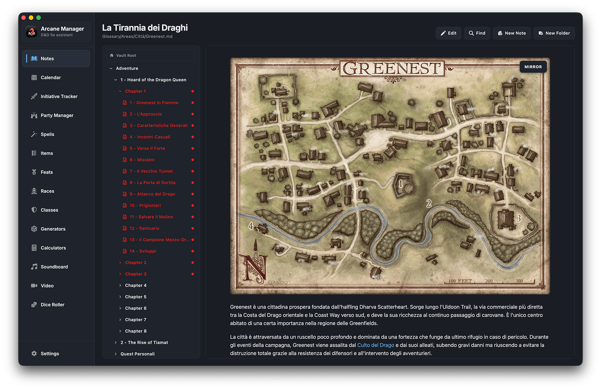
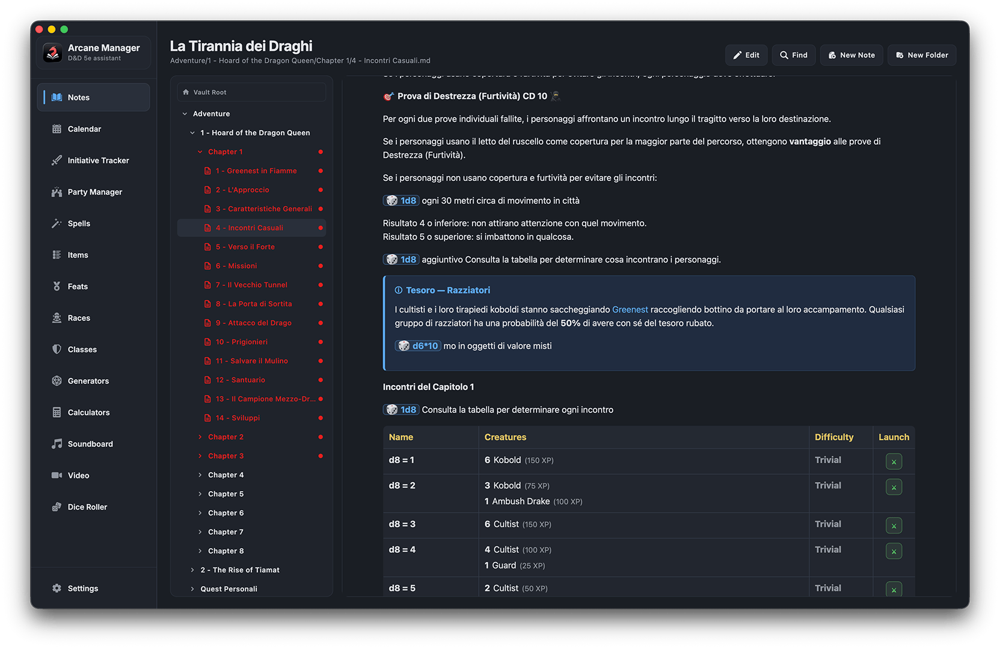

### Calendar

Build your own campaign calendar - months, weekday names, era, holidays, and
any number of moons with their phases - then browse/advance the campaign
date, add DM events with week/month/year recurrence, and link any event
into a note as a live‑updating reference. Each day's weather is
procedurally rolled from the campaign's chosen biome, with a manual per‑day
override, and a whole calendar can be exported and imported as a file.

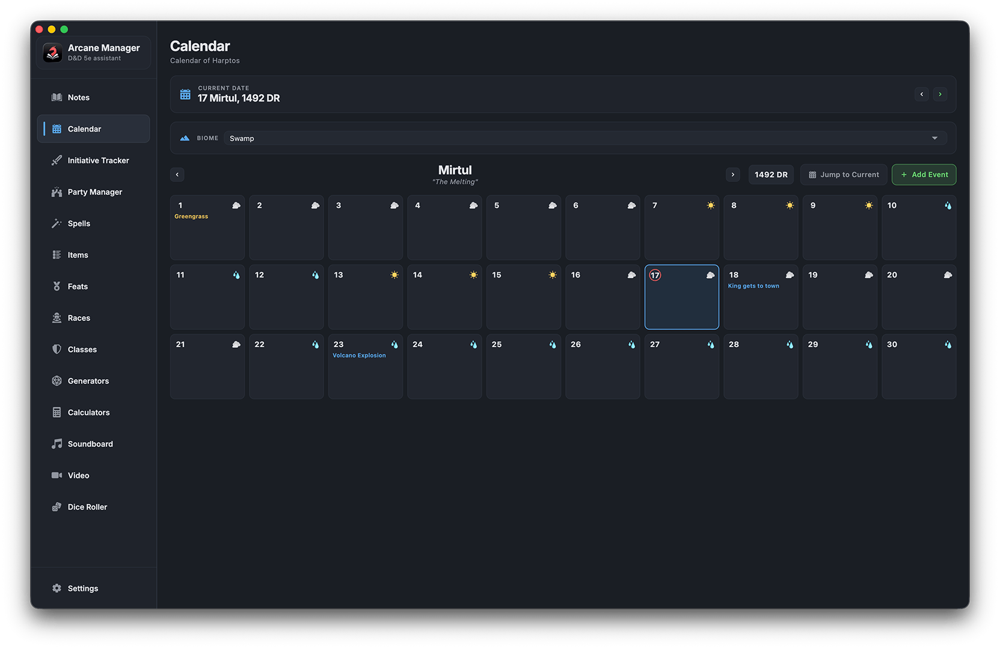

### Initiative

The combat tracker: rolled initiative, HP/status/conditions, turn
navigation, and a live DMG encounter‑difficulty readout before the fight
starts. A creature's statblock opens in a drawer with an interactive Cast
table - spells and limited‑use abilities roll their own dice and apply
damage or healing to a picked target, and a summon spell can drop its
creatures straight into the initiative order, bound to the caster's
concentration. Any combatant can transform into a bestiary creature (Wild
Shape, Polymorph) and revert with its original state intact, and a
character's bound companions - a familiar, a steed, a beast companion - join
the fight with them and can ride their turn instead of taking their own.
Death saves, auto‑Unconscious at 0 HP, and massive‑damage instant death are
all handled without DM bookkeeping.

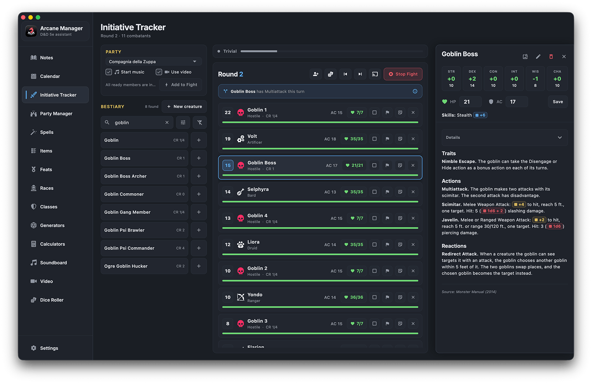

### Battle Map

Initiative's second sub-tab is a lightweight VTT for a second, separately
picked monitor laid flat on the table. A map library (folders, drag‑and‑drop
import, per-map grid alignment) sits next to the initiative order; one grid
calibration per physical monitor makes a map cell match a real 1" square.
Each combatant gets a token sized by creature size, with its portrait,
conditions ring, concentration glow and a rotating turn ring - and tokens
turn to face the active player's seat around the table. Distance, area,
cone and rectangle measurement tools plus a freehand pen can be shown to the
players or kept private, and optional coordinates overlay the grid.

A fog of war shows the players only what their characters can see: the DM
traces walls, doors and openings in a wall editor, each character has its
own sight range, and monsters outside it are never sent to the table screen
at all. Doors open and close during play, and a reduced-performance mode
keeps it smooth on slower machines.

### Party

Manage parties and characters (class, AC, level, HP, token portrait), assign
parties to a campaign, toggle "ready" before a session, and assign each
character a combat video for the external display plus the bestiary
creatures they bring into every fight. HP, conditions, and exhaustion level
stay live‑synced with the Initiative tracker, and a party‑wide Long Rest
button heals everyone, clears conditions, and steps exhaustion down in one
click.

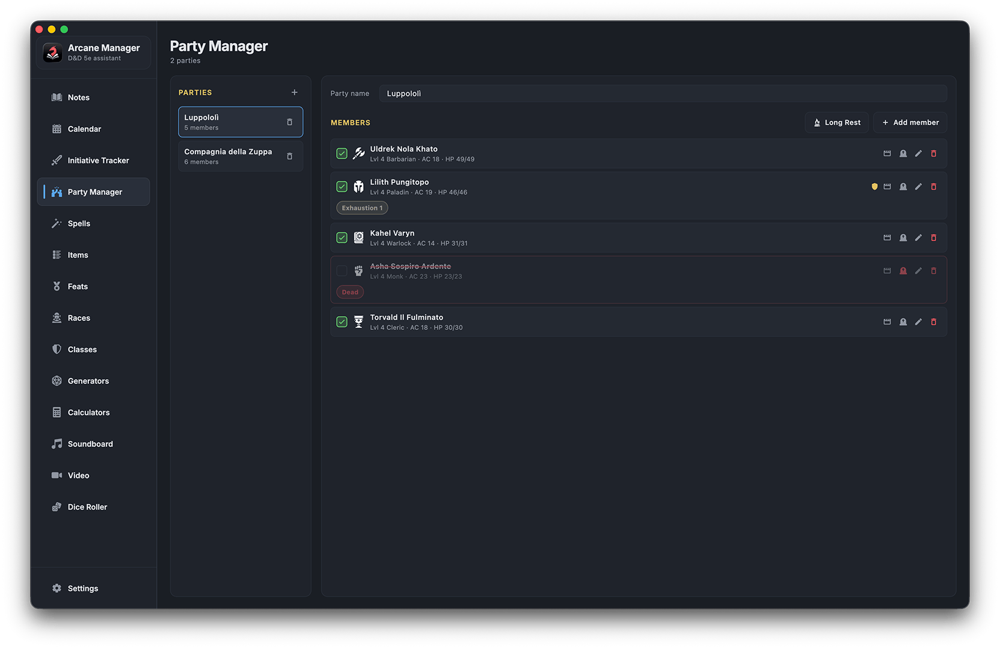

### Spells

Fuzzy bilingual (EN/IT) search with a detail view whose inline dice follow
that spell's actual scaling - a damage roll grows with slot level or
caster level exactly as written, not a flat approximation. DMs can author
and edit homebrew spells that live right alongside the SRD list.

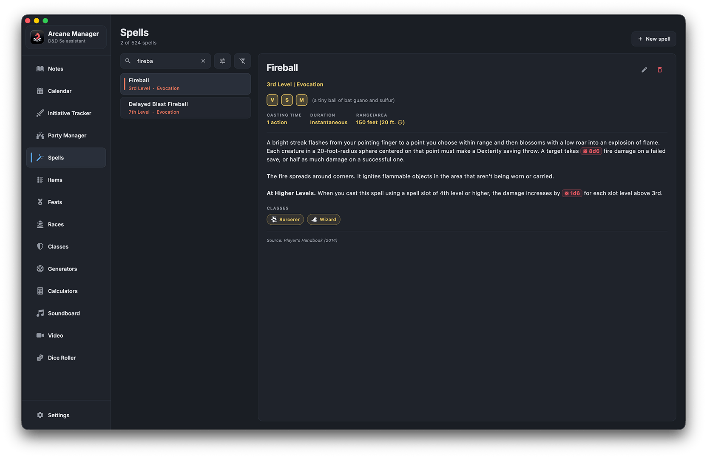

### Items

A searchable equipment browser with manual/book pricing. Most magic items
intentionally show no price until they're rolled into a generated shop's
stock, since 5e itself gives most of them no official one; DMs can author
custom items and named variants, printable to a reference-card PDF.

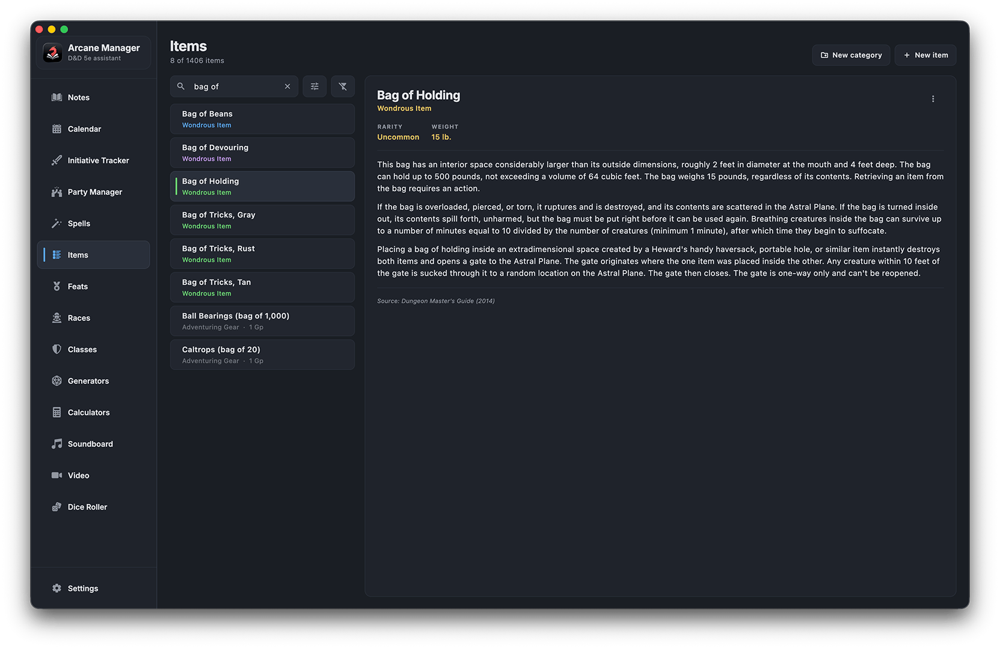

### Feats

A bilingual, searchable feat browser with prerequisites and full
descriptions, plus DM-authored custom feats alongside the SRD list.

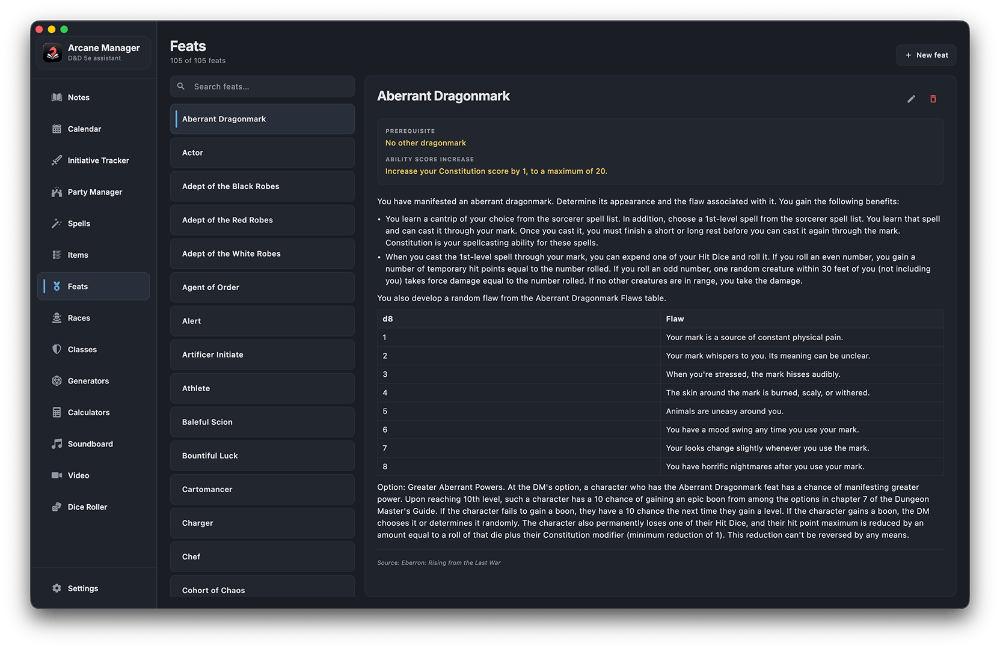

### Races

A bilingual race/subrace browser with lore and structured mechanics
(ability bonuses, darkvision, languages, combat traits) that also feed the
NPC generator, not just the page here. DMs can author custom races and
subraces the same way.

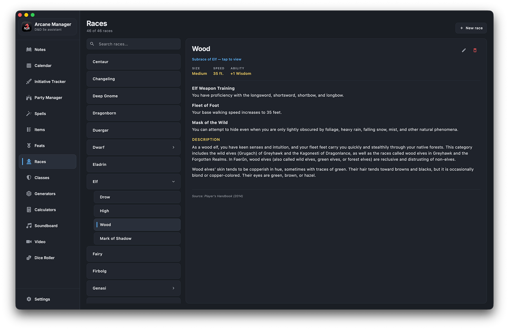

### Classes

A class/subclass browser with level-by-level features and progression
tables, named option pools (Eldritch Invocations, Metamagic, ...), and
starting-equipment/multiclassing data alongside the table. Searching a
subclass name (e.g. "Battle Master") jumps straight to its parent class
with that subclass pre-selected, and a DM can author whole custom
classes/subclasses.

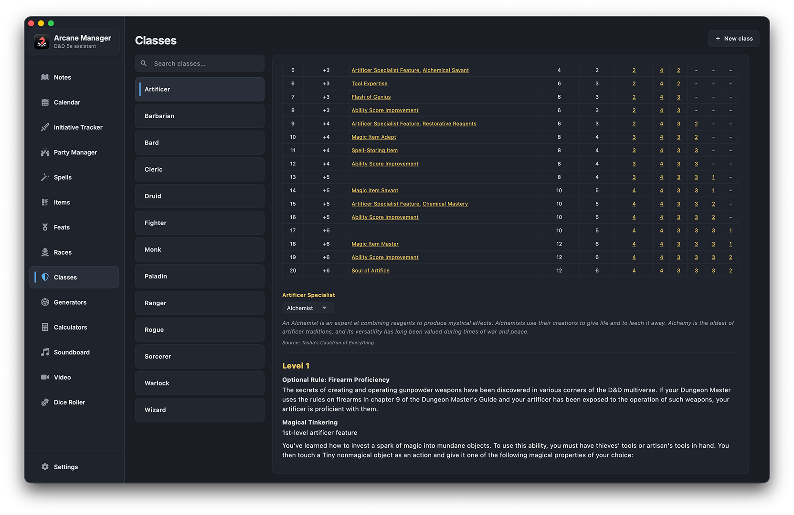

### Rules

A bilingual rules glossary - conditions, diseases, statuses, combat
actions, senses, skills, and variant/optional rules - with a category
filter, search, clickable dice/spell links, and a full editor for adding or
rewriting any entry.

### Tables

Rollable tables the DM writes or imports: a weighted list of outcomes
mapped onto a real die (a 5-entry table rolls a d10 in pairs, leftovers
become a reroll band), rolled with the 3D dice. Any note can embed a table
with `` `table: name` `` and roll it in place. The Wild Magic Surge table
ships as an importable file.

### Generators

Randomized content for the table, seven generators sharing one
lock/reroll/favorite pattern and a favorites drawer:

**NPCs** - a full NPC with appearance, height/weight, personality,
occupation and daily life, per‑field lock/reroll, and a lightweight
ability-score/attack character sheet.

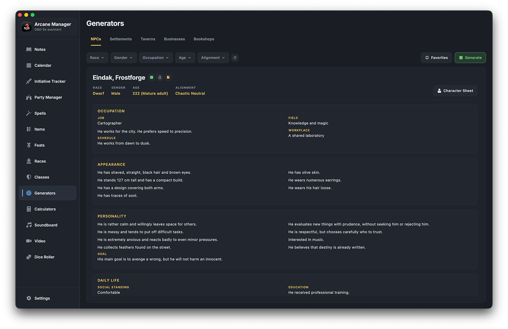

**Settlements** - a settlement with population, an authority figure,
notable citizens, a tavern, shops, and a procedurally composed coat of
arms; a ruined settlement type shows a reduced "abandoned" card instead of
the full roster.

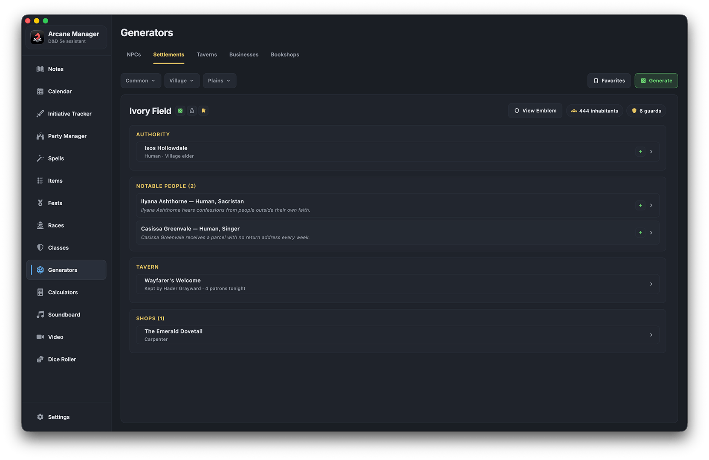

**Taverns** - an innkeeper, patrons, and a printable in‑fiction drinks/food
menu with its own prices and ABV.

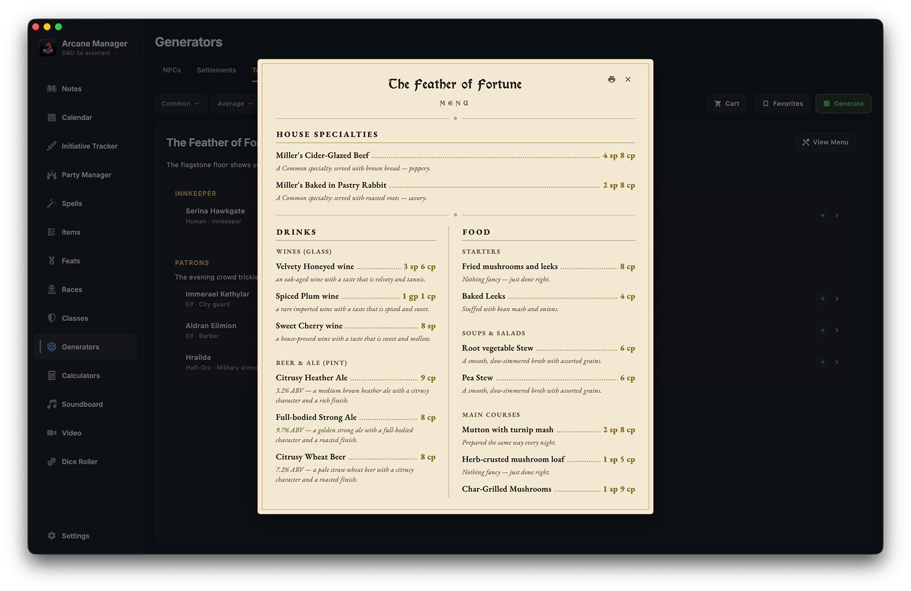

**Businesses** - an owner and current wares, with a shared shopping cart,
merchant‑mood/city‑wealth sliders that shift prices, and a scroll‑price
calculator.

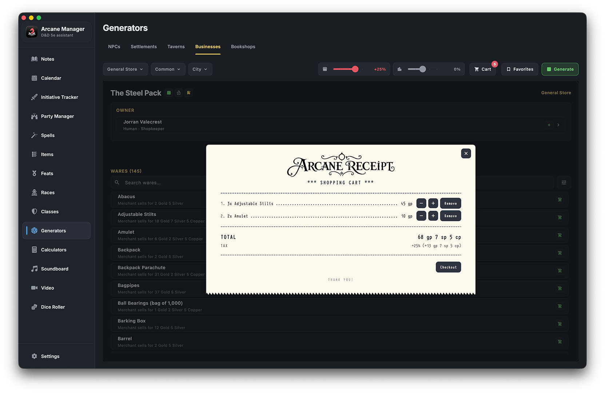

**Bookshops** - an owner and a searchable, sortable list of stock (by
title, genre, year, or price), each book's synopsis a tap away, sharing
the Businesses cart.

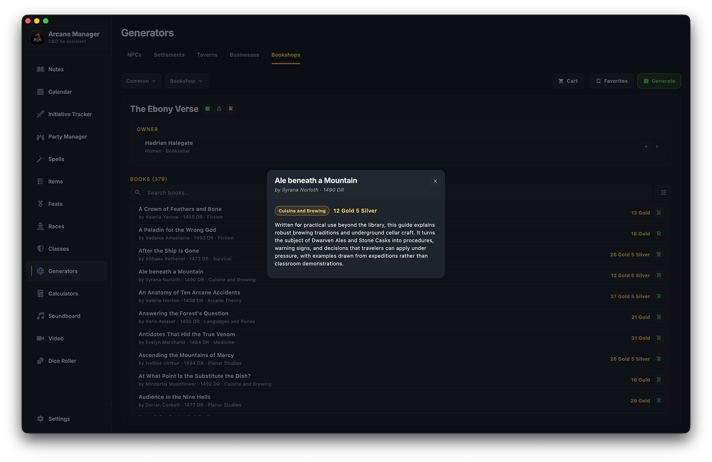

**Encounters** - a biome-appropriate, rarity-weighted group of creatures
(with their tagged allies) grown to a chosen DMG difficulty for the selected
party, ready to add to Initiative in one click.

**Treasure** - Individual Treasure and Treasure Hoard rolls by CR tier:
coins, gems, art objects, and magic items drawn from your own item list at
the right rarity.

### Calculators

Standalone DM math: travel time by pace/vehicle, fall damage, bounty
rewards, mercenary hire cost, a feet/meters/miles/kilometers distance
converter using D&D's own rounding, and a coin‑split calculator that pays
out without ever breaking a coin into smaller change.

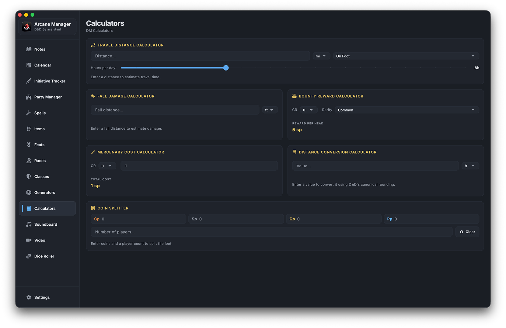

### Dice Roller

Build a dice pool and roll it with real **3D physics dice** - with impact
sounds - in a WebView overlay, with one-click Advantage/Disadvantage. Every
clickable dice link elsewhere in the app (spells, statblocks, notes, feats,
tables) rolls in the same overlay, which can also go full-screen on the
external display for the whole table to see.

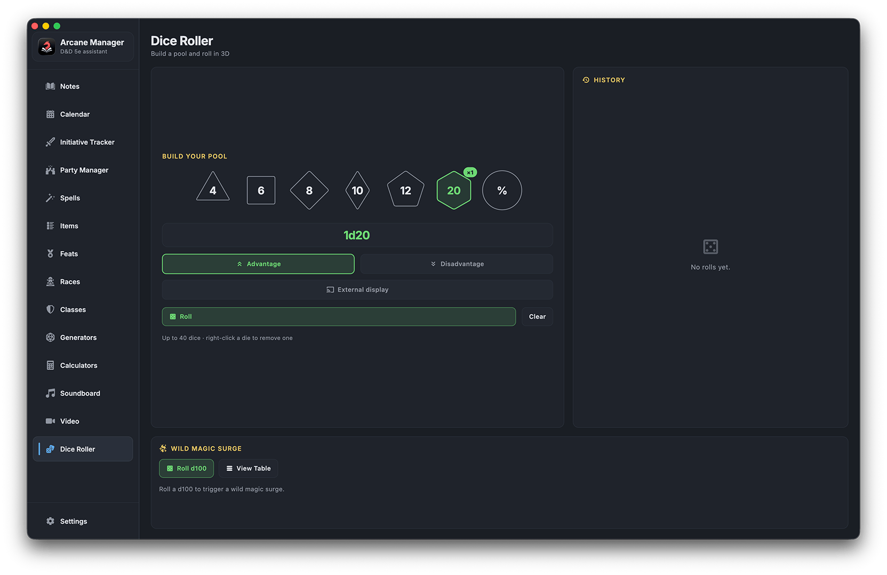
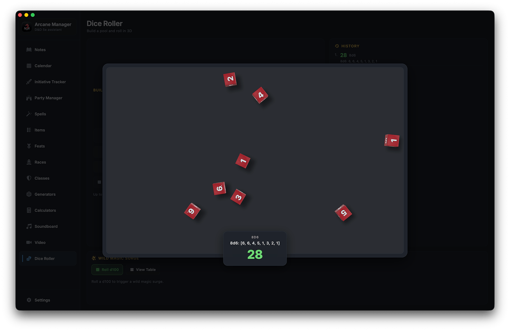

### Video

A local video and still-image library that plays out to a second monitor,
automatically switching to whichever combatant is acting during a fight (a
PC's own video, a creature's own battle video, a generic monster/ally/
lair-actions video, or an idle image), with crossfade/stinger transitions.
A clip that's been moved or renamed on disk is flagged as offline and can
be batch-relinked from a folder instead of silently breaking.

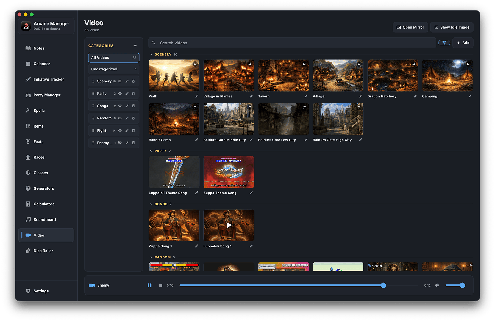

### Soundboard

Music, Ambient and SFX side by side, each with its own volume and its own
clip groups. Music crossfades between tracks and can auto-start shuffled
when a fight begins; any number of Ambient clips loop and layer at once;
SFX overlap freely on top of everything else.

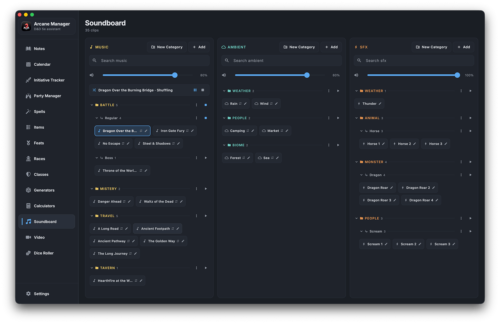

Plus a **Settings** panel (theme, display pickers and map-grid
calibration, sourcebook filters, tab visibility), a global **Command
Palette** for jumping straight to any spell, item, creature, race, feat or
rule, a shortcut-toggled floating **Quick Notes** scratchpad usable from any
tab, and a collapsible sidebar that peeks back on hover. Custom creatures
can carry a portrait - uploaded or picked from a web image search - that
doubles as their map token.

The installer bundles the official SRD 5.1 content (spells, creatures, items,
races, feats, classes, rules), offered once at first launch and available
anytime after via Settings > Import/Export > Restore SRD Content - off by
default, so a DM can just as easily start empty and bring only their own
data. Beyond the SRD, a DM imports whichever dataset(s) they want via
Settings > Import/Export, either one data type at a time or all of them at
once from a single folder.

## Tech

- Flutter (desktop: macOS / Windows / Linux), Riverpod for state,
  `shared_preferences` plus per-dataset JSON files (`path_provider`) for
  persistence, `flutter_inappwebview` + a small local HTTP server for the 3D
  dice, the Markdown reader and Mermaid diagrams, `file_picker` for the vault
  folder, `media_kit` for soundboard/video playback, `window_manager` /
  `desktop_multi_window` / `screen_retriever` for the external video and map
  monitors, `desktop_drop` for drag‑and‑drop imports,
  `flutter_localizations` + `intl` for the (currently EN/IT) UI
  localization, `pdf` for the printable tavern menu and item reference
  card, and `package_info_plus` + `http` for the GitHub‑release update
  check and the creature image search.

## Credits

For the third‑party libraries this app bundles and their licenses, see
[LICENSE.md](LICENSE.md), which also holds the Arcane Manager license.

*Fully vibecoded, zero shame about it - I designed every feature and
personally beat on every corner of this app until it held up. AI were
involved, but so was a lot of human love.*

Developed by **Giulio Maffei**, with heartfelt thanks to Francesco D., Alice,
Fabio, Benedetta, Cristina, Giorgio, Davide, Daniele, Michele, Ilaria,
Antonio, Lorenzo, and Ismael, for welcoming him into this wonderful game and
making it something worth building a whole app for.

Special thanks to Francesco M. for all his help with debugging and testing
the app.
